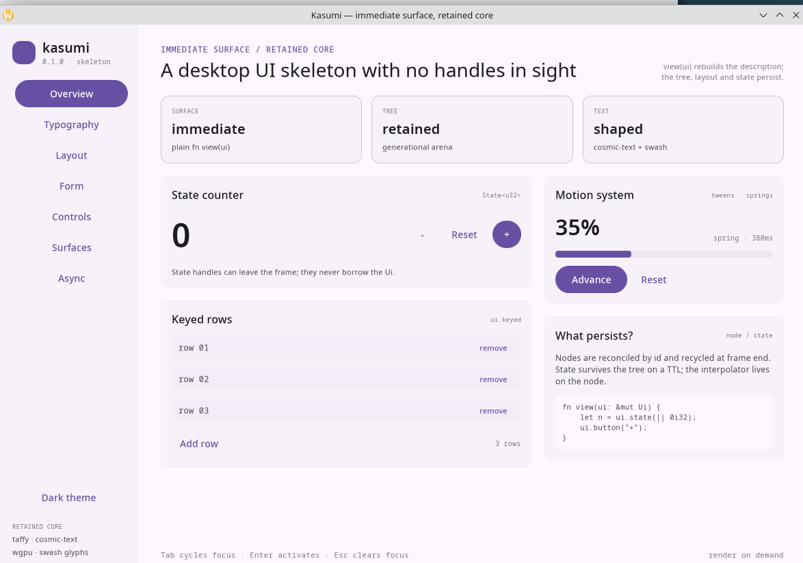

# Kasumi

Kasumi is a Rust desktop UI skeleton built around an immediate-mode `view(ui)`
function and a retained node tree. User code declares only the current frame;
nodes, layout caches, interaction state and state handles are owned by the
framework and never appear in the public API.

This is a working prototype, not a published or production-ready framework.



## What is implemented

- A layered workspace: core value types, typed state, retained tree, taffy
  layout, text/paint, the `Ui` facade and a winit backend with selectable
  `glow` (OpenGL) or `wgpu` renderers.
- A Material Design 3 theme: baseline light/dark color schemes, seeded
  schemes, the 15-role type scale, shape/elevation/motion/state-layer tokens,
  per-window theme switching and M3-styled controls.
- Flex, grid, stack, centered, wrapped and scrollable containers; labels,
  buttons, text fields, checkboxes, radios, sliders, combo boxes, dividers,
  progress bars, tooltips, nested menus, context menus and a navigation
  drawer/rail with collapsible groups.
- Elevated, filled and outlined cards plus modal dialogs with a blocking
  scrim, Escape/scrim dismissal and root-overlay rendering.
- Multi-window applications: one shared `App`, an independent runtime/GPU
  surface per window, and `Ui::open_window` / `close_window` / `windows`.
- Async resources with `Ui::resource`, `resource_keyed`, future-backed
  variants, loading/ready/error status, stale-while-revalidate reloads,
  cancellation, TTL eviction and cross-thread event-loop wakeups.
- RGBA images, resvg-backed SVG, CommonMark/GFM Markdown and QR-code widgets.
- A retained scroll view with wheel, keyboard and scrollbar input, using
  Chromium's eased wheel animation.
- Virtual scrolling through `ScrollView::virtual_content` and
  `Ui::virtual_scroll`, plus a fixed-height `ListView` that declares only the
  visible rows around a 10,000-item list.
- Single-line text editing with mouse-drag selection, horizontal scrolling,
  word and line navigation, undo/redo, IME pre-edit and system clipboard
  Ctrl/Cmd+A/C/X/V support.
- Position-derived element ids, optional explicit keys for lists and
  conditional branches, duplicate-id detection in debug builds.
- A generational node arena. Nodes are reused across frames and recycled at
  frame end when they are not declared.
- Typed `State<T>` handles with TTL eviction, persistent state and automatic
  repaint requests.
- Incremental taffy layout: only style/content/child-list changes are pushed
  into taffy, and taffy's cache skips clean subtrees.
- An experimental `kasumi-text` backend: font discovery, Unicode itemization,
  per-cluster fallback, bidi line breaking and swash shaping, plus glyph
  rasterization. The renderer packs masks and color glyphs into one RGBA atlas
  and issues a single instanced OpenGL draw call for rectangles, glyphs and
  images.
- Event-driven rendering: idle windows do not run `view`, and pointer moves
  that stay inside the same hover target do not produce frames.
- Retained tween and spring animation channels, visual opacity/translation/
  scale transforms, reduced-motion-friendly presence transitions, and animated
  controls including combo popups, checks, radios, sliders and progress.
- An accessibility snapshot API and a small demo with counters, keyed rows,
  typography samples and animation.

## Requirements

- Linux with system fonts available through fontconfig. The default `glow`
  backend needs OpenGL 3.3; the `wgpu` backend needs a Vulkan, GLES, Metal or
  DX12 adapter supported by wgpu 30. The backend uses winit's X11 and Wayland
  features. The web is not wired up.
- Rust 1.88 or newer. The workspace uses edition 2024.

## Run the demo

```sh
cargo run --release -p kasumi-demo

# Select the wgpu backend without compiling glutin/glow.
cargo run --release -p kasumi-demo --no-default-features --features wgpu
```

The backend crates use mutually exclusive `glow` and `wgpu` features. Selecting
neither or both is a compile error, so embedders cannot accidentally pay for or
link both render paths. The winit event loop, input normalization, clipboard,
IME, animation clock, layout and paint layers are shared.

Diagnostics:

```sh
# Print GL information and per-frame layout/paint statistics.
KASUMI_STATS=1 cargo run --release -p kasumi-demo

# Render the overview without its startup animation, then quit after four
# frames. Useful for the static-frame measurements below.
KASUMI_STATS=1 KASUMI_DEMO_TARGET=0 KASUMI_EXIT_AFTER_FRAMES=4 \
    cargo run --release -p kasumi-demo

# Open another demo page: 0 overview, 1 typography, 2 layout, 3 form,
# 4 controls, 5 surfaces (cards, dialogs and windows), 6 async resources.
KASUMI_DEMO_PAGE=1 cargo run --release -p kasumi-demo

# Start in the baseline dark scheme. The sidebar button toggles light/dark
# at runtime; the transition is per-window.
KASUMI_DEMO_DARK=1 KASUMI_DEMO_PAGE=1 cargo run --release -p kasumi-demo
```

## Minimal example

```rust
use kasumi::prelude::*;
use kasumi::App;
use kasumi_backend::{run, WindowOptions};

struct Counter;

impl App for Counter {
    fn view(&mut self, ui: &mut Ui) {
        let count = ui.state(|| 0i32);

        ui.column(|ui| {
            ui.size_full().padding(24.0).gap(12.0);
            ui.add(Label::new("Counter").font_size(22.0).semibold());

            ui.row(|ui| {
                ui.gap(8.0);
                if ui.button("-").clicked() {
                    count.update(|value| *value -= 1);
                }
                ui.add(
                    Label::new(count.get().to_string())
                        .font_size(28.0)
                        .family(FontFamily::Monospace),
                );
                if ui.add(Button::new("+").primary()).clicked() {
                    count.update(|value| *value += 1);
                }
            });
        });
    }
}

fn main() {
    run(Counter, WindowOptions::default()).expect("kasumi event loop");
}
```

`view` is called once per rendered frame. The function returns nothing and
cannot return a borrow of the tree. The only values that can leave the frame are
`State<T>`, plain application data and the `Response` values returned by
widgets.

The same program is in
[demo/examples/counter.rs](demo/examples/counter.rs) and is compile-checked with
the rest of the workspace.

## Frame pipeline

1. The backend converts winit events into an `InputState` and computes the
   device scale and logical viewport.
2. `Runtime::frame` processes input against the previous layout. Hover, active
   and focus targets are resolved here. Hit testing against the previous frame
   is deliberate: a widget's current size is not known until `view` returns.
3. `view` runs with a `Ui`. Every declaration is reconciled by id into the
   retained tree. A new id allocates a node; a matching id reuses it.
4. `Tree::end_frame` commits child order, recycles nodes that were not touched
   and ends the state TTL window.
5. `LayoutEngine` updates the changed parts of its taffy mirror and runs layout.
   Absolute rectangles are written back to the nodes.
6. The paint pass walks the committed tree and appends rects and positioned
   glyphs to one `DrawList`, preserving z-order.
7. The backend uploads the draw list as one instance buffer and renders it with
   one shader. A frame is requested again only for animations, explicit
   repaint requests or input that changes what is on screen.

## Identity and reconciliation

The `Ui` holds an id scope and a sibling counter. A child id is
`mix(parent_scope, sibling_index)`. Containers become the scope for their
children. `ui.keyed(key, |ui| ...)` replaces the sibling-derived scope with
`hash(parent_scope, key)`, so reordering keyed items does not reparent their
subtrees.

State ids use a separate namespace. Adding or removing a `ui.state` call does
not shift widget ids.

Every declared node id is checked against a per-frame table that records which
widget declared it. A duplicate panics with the id, the frame number and both
origins. Duplicate ids are normally caused by an unkeyed conditional branch or
by reordering unkeyed siblings; wrapping the branch in `ui.keyed` fixes both
cases.

## State and interaction

`ui.state(|| value)` returns a cloneable `State<T>`. Handles can be stored on
application structs or captured by closures; they do not borrow the `Ui`. The
API is `get()` (requires `Clone`), `with()` for a zero-copy read, `set()` and
`update()`. All writes request a repaint. Since a write can happen after the
widgets that read the value were declared, a write schedules one follow-up
frame; that frame is also the point at which the rendered result observes the
new value. State ids use a namespace separate from node ids, so adding or
removing a state call does not shift widget ids.

Values whose `ui.state` call stops running for 600 frames are evicted.
Declaring a slot keeps it alive, so a value that is declared every frame but
read only occasionally (a draft, an id allocator) holds its value: eviction
follows declaration, not reads. `ui.state_persistent` opts a value out of
eviction; `Runtime::set_state_ttl_frames` changes the window. An evicted handle
re-runs its initializer on the next access.

Widgets return `Response`, which reports `hovered`, `pressed`, `clicked`,
`released`, `dragged`, `context_clicked`, `focused`, `changed` and the current
scroll offset. Hover and click resolution uses the previous frame's
rectangles, as described above. Tab order is the depth-first order of
focusable nodes in the current tree. Enter and Space activate focused buttons,
checkboxes, radios and combo boxes.

The text field keeps caret, selection and undo state on its retained node while
the text itself remains a `State<String>`. It supports Shift+arrows,
Ctrl/Cmd+arrows, Home/End, Delete/Backspace, Ctrl/Cmd+Z, Ctrl/Cmd+Shift+Z,
Ctrl/Cmd+A/C/X/V, mouse selection and IME composition. The backend owns the
system clipboard integration.

`Runtime::a11y_snapshot` produces a flat list of roles, labels, bounds, depth
and focus state from the retained tree. It is a data API only; there is no
platform integration yet.

## Menus

`Menu` is declarative data, not callbacks: items, shortcuts, check marks and
arbitrarily nested submenus. The menu is retained under the anchor widget's id
and activation reports the path through the tree, so one `match` dispatches
every command:

```rust
let menu = Menu::new()
    .item(MenuItem::new("Open").shortcut("Ctrl+O"))
    .submenu("Export", Menu::new().item("PNG").item("SVG"))
    .separator()
    .item(MenuItem::new("Delete").enabled(false));

if let Some(selection) = ui.menu(&anchor, menu) {
    match selection.path.as_slice() {
        [0] => open(),
        [1, 0] => export_png(),
        [1, 1] => export_svg(),
        _ => {}
    }
}
```

`ui.context_menu(&response, menu)` opens the same menu at the pointer on a
right click, and `MenuButton::new("File", menu)` packages the button and the
menu into one widget.

Submenus cascade to the right of their parent row. Hovering a parent opens it
after `Menu::hover_delay` (400 ms by default, matching Material), clicking it
toggles the level immediately, and `→` / `←` or `Enter` / `Space` / `Escape`
drive the same state from the keyboard. Panels are placed from a root overlay
so they paint above page content, and a full-window scrim swallows presses that
land outside the menu; the menu closes in that frame and the press does not
reach the widget underneath. A menu whose parent row disappears is dropped by
`Tree::end_frame`, so nothing leaks.

Menus use the M3 menu tokens: surface-container at elevation level 2, an
extra-small (4 dp) corner radius, 48 dp rows with 16 dp padding, a leading
check-mark column when any row is checkable, right-aligned shortcut hints, and
a 1 dp outline-variant border. Panels enter with a fade and an 80 %→100 % scale
spring from their top edge, the Material menu entrance.

## Navigation drawers and rails

`NavigationDrawer` describes destinations once and renders them as a
permanent sidebar, a modal drawer or a rail:

```rust
let nav = NavigationDrawer::new()
    .header(NavHeader::new("kasumi").subtitle("0.2.0"))
    .item(NavItem::new("overview", "Overview").icon("◉"))
    .section("Data", |section| {
        section
            .item(NavItem::new("lists", "Lists"))
            .item(NavItem::new("search", "Search"))
    })
    .item(
        NavItem::new("settings", "Settings")
            .child(NavItem::new("theme", "Theme")),
    )
    .footer(NavItem::new("theme-mode", "Dark theme").icon("◐"))
    .selected(&current);

if let Some(key) = ui.navigation(&nav).selected {
    navigate(key);
}
```

Items are identified by a stable key, and the drawer reports the activated
key instead of running callbacks. Sections render a `title-small` heading (or a
rule in rail mode), the footer is pinned below the scrolling list, and a
parent item toggles its group without navigating. Nested groups keep the flat
Material row metrics and gain one `12 dp` step of indentation per level, so a
deep tree never shrinks its rows; a group's chevron animates with the same
spring as the row state.

Passing `.selected(key)` paints the active indicator and expands the
selection's ancestors on the first frame, so a selection restored from
persisted state is visible immediately.

The visual treatment follows the M3 drawer and rail tokens: 56 dp rows with a
full-radius `secondary-container` indicator inside a 12 dp inset, icons and
labels in `on-secondary-container` when selected and `on-surface-variant`
otherwise, a 16 dp corner radius on the modal drawer's trailing edge, and a
96 dp rail (`NavVariant::Rail`) that centers icons and keeps labels in the
accessibility tree only. The drawer's list scrolls without a persistent
scrollbar, which is what Material specifies; `NavigationDrawer::scrollbars(true)`
opts back in.

The demo's sidebar is now one `NavigationDrawer` with two sections, a
collapsible group and a theme-mode footer entry.

## Cards and dialogs

`Ui::card(Card::new(), |ui| ..)` declares a themed column container. `Card`
selects the elevated, filled or outlined treatment and controls padding, gap,
size and radius. Elevated cards use a tonal surface plus a hairline border;
the renderer does not implement shadows yet. A clickable card gets a pointer
cursor, keyboard focus and a previous-frame hover tint.

`Ui::dialog(Dialog::new(&open).title(..), |ui| ..)` renders a modal through the
root overlay layer while the `State<bool>` is true. The widget paints a
full-window scrim that captures pointer and wheel input before the page below
and centers a card. It closes on Escape or a scrim click when `dismissible` is
enabled. Keyboard focus is not trapped; that is deliberately left to the
application, and dialog bodies are ordinary immediate-mode content.

Dialogs are real retained nodes only while open. Closing the state removes the
overlay on the next frame, so no hidden dialog tree keeps consuming layout or
paint time.

## Multiple windows

The winit backend can run many windows against one shared `App`:

```rust
fn view(&mut self, ui: &mut Ui) {
    if ui.window().is_primary() {
        if ui.add(Button::new("Inspect")).clicked() {
            ui.open_window(
                WindowRequest::new("Inspector").size(560.0, 700.0),
            );
        }
    } else {
        // The same application object, rendering a different window.
        let key = ui.window().key;
        if ui.add(Button::new("Close")).clicked() {
            ui.close_window(key);
        }
    }
}
```

Each window owns a `Runtime`, retained tree, layout engine, GPU surface and
`StateStore`. That isolation is intentional: a `State<T>` created in the main
window is not shared with a secondary window. Share cross-window data through
application fields (for example an `Arc<Mutex<_>>`) or the window's
`App::view` itself. `Ui::windows()` returns a snapshot sorted by `WindowKey`
with title, logical size, scale factor, primary/focused flags. Window actions
are executed by the backend after the current frame is presented; a newly
opened window first appears on a later frame. Closing the last window exits
the event loop.

The single-window `run(app, WindowOptions)` entry point is unchanged; it uses
`WindowKey::MAIN` and the same multi-window machinery internally.

## Async resources

`Ui::resource_keyed(key, loader)` returns a cloneable `Resource<T>` and starts
`loader` on a small background executor the first time that key is declared.
The UI thread never blocks. Position-based `Ui::resource(loader)` exists too,
but keyed resources survive conditional branches and reordered siblings.

```rust
let users = ui.resource_keyed("users", || {
    api::fetch_users().map_err(|error| error.to_string())
});
match users.status() {
    ResourceStatus::Loading if users.has_value() => {
        ui.label("Refreshing…");
    }
    ResourceStatus::Loading => {
        ui.label("Loading…");
    }
    ResourceStatus::Failed => {
        if let Some(error) = users.error() {
            ui.label(format!("Failed: {error}"));
        }
    }
    ResourceStatus::Ready => { /* users.with(|users| ..) */ }
    ResourceStatus::Idle => {}
}
if ui.button("Retry").clicked() {
    users.reload();
}
```

A reload keeps the previous value available while `status()` is `Loading`, so
UIs can show stale data during a refresh. `cancel()` invalidates an in-flight
load and clears the value; `set(value)` installs an optimistic value. Loaders
must be `Fn() -> Result<T, E> + Send + Sync + 'static` because a resource can be
retried, and the error must implement `Display` so it can be flattened into a
`ResourceError` and moved back to the UI thread. Values are `Send + 'static`.

`Ui::resource_future_keyed` accepts a future factory instead. The shared
executor polls the future with a thread-unpark waker. It is a plain executor,
not an I/O reactor: futures that depend on tokio or another reactor must bring
that runtime with them.

`ResourceStore` caches handles by id and expires slots that have not been
declared for the resource TTL (600 frames by default,
`Runtime::set_resource_ttl_frames`). External clones stay valid after
eviction; declaring the slot again starts a fresh load.

Completion signaling is event-driven. Each runtime installs a wake callback
through `set_resource_wake_callback`; the winit backend wraps an
`EventLoopProxy` so a worker finishing while every window is idle wakes the
event loop and schedules exactly one redraw. No polling timer is involved.

## Material Design 3 theme

`Theme` is plain data, not a global singleton. Build one of the baseline
schemes, derive one from a seed color, or assemble a custom scheme:

```rust
use kasumi::{ColorScheme, Theme, ThemeMode};

let light = Theme::light();
let dark = Theme::dark();
let seeded = Theme::from_seed(Color::hex("#006B5E"), ThemeMode::Dark);
let custom = Theme::from_scheme(ColorScheme::baseline_dark(), ThemeMode::Dark)
    .with_font_family(FontFamily::Named("Noto Sans".into()));
```

Every color role follows the `md.sys.color.*` naming used by the
[Material 3 color system](https://m3.material.io/styles/color/overview):
primary, secondary, tertiary, error and their on/container/fixed variants;
surface, surface-dim/bright and the five surface-container roles; on-surface,
outline, outline-variant, inverse roles, scrim and shadow. `background` and
`on-background` are aliases of the surface roles for older code. `success` is
a Kasumi extension because M3 does not define a normative success role.

`Theme::from_seed` derives tonal palettes in OKLCH and gamut-clips them to
sRGB. It preserves the seed hue and the relative tonal relationships, but it
is an approximation of Material's HCT-based dynamic color, not a port of it.

The type scale contains all 15 baseline roles from the
[M3 typography tokens](https://m3.material.io/styles/typography/type-scale-tokens):
display large/medium/small, headline, title, body and label. Each role carries
the official size, line height, weight and tracking (expressed in logical
pixels and converted to em at shaping time). Apply a role with
`Label::style(theme.typography.headline_medium.clone())`; per-label overrides
still win. Typography is generated with the on-surface color and can be
recolored with `Typography::with_color`.

Shape, elevation, motion and state layers are exposed alongside the colors:

```rust
theme.shape.extra_large;        // 28 dp
theme.elevation.level3;         // 6 dp
theme.surface_at_elevation(2);  // surface-container
theme.motion.duration.short4;   // 200 ms
theme.motion.easing.emphasized; // cubic-bezier(0.2, 0, 0, 1)
theme.state.hover;              // 0.08
```

The paint layer has no shadow primitive yet, so elevated components use tonal
surface containers instead of real shadows. `Card` maps to surface-container-low
(elevated), surface-container-highest (filled) and surface + outline
(outlined). Dialogs use surface-container-high with a 28 dp radius and a 32%
scrim. Buttons expose filled, tonal, outlined, text and elevated emphasis plus
the legacy `primary`/`secondary`/`subtle` aliases. Menus, tooltips, text fields,
checkboxes, radios, sliders, progress indicators and scrollbars all read the
same roles.

`Ui::set_theme(theme)` changes the active theme for the current window. Widgets
declared after the call use the new tokens immediately, and a follow-up frame
repaints the nodes declared before it. Each window has its own theme, so a
secondary inspector can stay light while the main window is dark.

The demo's typography page renders the type scale and the color roles; the
surfaces page shows button variants, shape tokens and elevation tiles. Toggle
`KASUMI_DEMO_DARK=1` or press the sidebar button to inspect both schemes.

## Layout

`kasumi-layout` mirrors the tree into a taffy tree. Flexbox and CSS grid are
both supported; `ui.grid(columns, ..)` uses equal fractional tracks and
`ui.grid_with(..)` accepts explicit `GridTrack` values. `ui.stack(..)` places
all children in one grid cell. Styles are only pushed for nodes whose style or
text content changed, and child lists are only pushed when the committed order
changed. Taffy's cache handles the rest.

`ui.grow(factor)` sets the flex-grow factor. Flex items default to their
content width as the flex base, so proportional columns should also call
`ui.basis(0.0)` to distribute all free space strictly by the grow ratios.

Text nodes are measured through a `TextMeasure` trait implemented by
`kasumi-paint::TextEngine`. The paint pass shapes at the width recorded by the
layout measure pass, so the reserved height and the rendered lines agree.
Paragraphs that must wrap should set an explicit width through
`Label::width(...)` or a fixed-width parent; the demo's typography page does
this.

## Text

`kasumi-text` is the framework's text backend. It is a separate crate so the
font database, shaping caches and rasterizer can be reused and benchmarked
without the paint layer:

- `fontdb` discovers system fonts. Generic sans/serif/mono families are picked
  once from an ordered platform preference list; named families are resolved
  through fontdb's CSS-like query.
- Each paragraph is analyzed once with swash's Unicode tables. Bidi levels
  come from `unicode-bidi`, and paragraphs are split into runs with one level
  and one script.
- Swash's cluster shaper shapes each run. A per-cluster selector checks the
  primary face first and then a category-ordered fallback list (emoji, CJK,
  generic). Font bytes load lazily, and coverage decisions are cached per
  character, so repeated CJK or emoji runs do not rescan the font database.
- Line breaking uses `unicode-linebreak` (UAX #14). Bidi reordering applies
  UAX #9 rule L2 at cluster granularity; explicit newlines become separate
  paragraphs and are stacked. Glyphs inside a cluster stay in logical order
  for correct mark placement.
- Variable weight/italic axes and faux bold/italic are derived from swash's
  synthesis table, so a fallback face keeps the requested style.
- Swash rasterizes glyph outlines, color outlines and bitmap emoji. The
  renderer packs masks and color emoji into one RGBA atlas. Masks are uploaded
  as replicated alpha, color glyphs as RGBA.
- Glyphs are emitted as textured quads in the same instance stream as rects.
- The layout cache is keyed by text, family, weight, italic, size, line
  height, letter spacing, wrapping mode and available width. The cache holds up
  to 2048 layouts and clears as a whole when full.
- Glyphs are rasterized at `font_size * scale_factor`, quantized to quarter
  pixels, and cached in the atlas by face, glyph, device size and quarter-pixel
  subpixel phase. The outline absorbs the fractional pen position so each
  glyph quad can be snapped to whole device pixels and sampled 1:1, which
  avoids the soft, top-clipped edges caused by resampling the atlas.

The CJK sample in the demo exercises the system fallback chain; on this machine
it resolves to Noto Sans CJK through fontconfig. CJK punctuation (which has
Unicode script `Common`) is routed to the CJK fallback list as well, so a mixed
paragraph does not mix punctuation from an unrelated Latin face.

### Text microbenchmark

```sh
cargo run --release -p kasumi-text --example bench
```

The harness warms the shaper and then measures cache hits, unique Latin
layouts, unique mixed CJK/emoji/RTL layouts and glyph rasterization. These are
medians from the release build on the development machine (Loongson-3A6000,
Linux, loongarch64):

| Workload | cosmic-text path (old) | `kasumi-text` |
|---|---:|---:|
| Cached layout lookup | ~176 ns | ~156 ns |
| Unique Latin layout, 43 chars | ~60 µs | ~21 µs |
| Unique mixed CJK/emoji/RTL layout | ~205 µs | ~39 µs |
| Glyph rasterization, per glyph | ~45 µs | ~45 µs |

The old column was measured before the dependency was removed, with an
equivalent temporary harness against the previous `TextEngine`. Rasterization
is unchanged because both engines call swash; the gain comes from analysis,
fallback and line breaking running in-process without a second shaping pass.
Font discovery still costs about 50 ms when the process starts, before the
first frame.

Assembly was evaluated and deliberately deferred. Profiles show the remaining
cost is inside swash's outline engine and font cache, not in a vectorizable
loop owned by this crate; a hand-written kernel would be architecture-specific
and would not move the dominant term. The benchmark harness is kept so a future
`asm`/SIMD feature can be justified by a measured kernel rather than added
speculatively.

## Scrolling and rich content

Scroll containers retain a rendered offset and a pending destination. Wheel
input follows Chromium's scroll-offset animation: each notch adds 120 logical
pixels to the target, and the rendered offset eases toward it with an
ease-in-out cubic Bézier whose duration runs from 200 ms for a single notch
down to 100 ms for long targets. Further notches retarget the running segment
from its current position and velocity, so rapid input accumulates instead of
restarting. High-resolution pixel deltas apply immediately because the device
already produced smooth motion, and scrollbar drags update the offset directly
while cancelling any wheel animation. Keyboard arrows, Page Up/Down and
Home/End scroll focused viewports with the same eased segment. Hit testing and
painting apply ancestor scroll offsets without re-running layout.

Wheel routing stops at the nearest scrollable ancestor that has overflow on the
requested axis. Once that viewport captures the event it keeps it at its edges
instead of chaining the gesture into the page behind it, so scrolling a nested
list cannot move the surrounding page. A nested viewport whose content fits has
no scroll range and is skipped, leaving the page scrollable through it.

### Virtualized lists

`ScrollView::virtual_content(width, height)` declares the full scrollable
extent without laying out children outside the viewport. Pair it with
`Ui::virtual_scroll`, whose closure receives a `ScrollWindow` describing the
retained offset, the viewport from the previous layout pass and a clamped
`row_range` helper. Only the declared children exist in the tree, while the
scrollbar and wheel range still use the full extent.

`ListView::new(row_count, row_height, |ui, index| ..)` packages the common
fixed-height case. Rows are absolutely positioned at `index * row_height`
inside one content node; the list adds an overscan band (240 logical pixels by
default) so a fast scroll does not reveal an empty frame while the next layout
runs. Because off-screen rows are recycled immediately, local widget state in a
row is not retained across virtual eviction; lift shared values into
`State<T>`. Clipped nested scroll content is excluded from an ancestor's
scrollable overflow, so a 10,000-row virtual list nested inside a page does not
make the page believe it is 10,000 rows tall.

```rust
ui.add(
    ListView::new(rows.len(), 48.0, |ui, index| {
        ui.row(|ui| {
            ui.width_full().height_full().padding_xy(16.0, 0.0);
            ui.label(&rows[index].title);
        });
    })
    .size(Length::Percent(100.0), 320.0),
);
```

Programmatic scrolling uses `Ui::scroll_to(&response, Point::new(x, y))` or
`Ui::scroll_by(&response, Vec2::new(dx, dy))`. The latter keeps the smooth
wheel animation; the former cancels it and clamps to the retained range.

Images are decoded through `image` and uploaded once by content id. SVG is
rasterized through resvg/tiny-skia, Markdown is parsed with pulldown-cmark and
QR codes are generated from the `qrcode` encoder. All of these produce ordinary
RGBA atlas entries and remain in the same ordered draw list as text.

## Rendering

The backend exposes two mutually exclusive feature-selected renderers:

- `glow` (default): OpenGL 3.3 core through glutin and glow.
- `wgpu`: wgpu 30.0.1 with WGSL, explicitly enabling Vulkan, GLES, Metal and
  DX12. Cargo still trims target-specific APIs during a native build.

Both consume the same ordered `DrawList` and atlas allocations. The wgpu path
handles surface capability selection, resizing, suboptimal/outdated/lost
surfaces and bounded submission polling.

Scrolling remains available when a scroll view hides its scrollbar with
`ScrollView::scrollbars(false)`; only the rail and thumb paint calls are
suppressed.

One `#[repr(C)]` instance struct describes rectangles, glyphs and images. The
vertex shader expands four vertices per instance; the fragment shader either
evaluates a rounded-box signed distance field with border coverage, or samples
the atlas. Output is premultiplied alpha with `ONE, ONE_MINUS_SRC_ALPHA`
blending. Clipping is a per-instance rectangle test in the fragment shader, not
a scissor or a rounded clip.

Colors are stored as sRGB components and written to a non-sRGB framebuffer.
There is no linear-light color pipeline.

## Animation

Animation state is retained on nodes and driven by one runtime timeline, so
idle animations do not force unconditional continuous rendering.

```rust
let progress = ui.animate_with(
    "panel-open",
    1.0,
    MotionSpec::spring(Spring::new(0.24, 0.82)),
);

ui.transition("details", show_details, Transition::popover(), |ui| {
    ui.column(|ui| {
        ui.gap(8.0);
        ui.label("Animated content");
        ui.label(format!("{progress:.2}"));
    });
});

let switch_alpha = ui.transition_switch("tab", selected_tab, Transition::fade());
if let Some(visual) = ui.visual() {
    visual.opacity.snap(switch_alpha);
}
```

`Ui::animate` remains the simple tween API. `animate_with` supports named
channels, tween curves and critically/near-critically damped springs. The motion
types are re-exported from the facade prelude. A `Transition` controls initial
opacity, translation and scale; conditional content is retained during its exit
animation. `Ui::visual`, `opacity`, `scale`, `translate` and `transform_origin`
are available to custom widgets.

Visual transforms affect painting and do not mutate layout. The current
compound alpha and opacity are passed down the paint walk.

## Performance

Measured on the development machine (Linux, Mesa 26.1.6, AMD RX 5500 XT,
loongarch64) with the release build:

| Scene | Nodes | Primitives | Layout updates | Measures | CPU per frame |
|---|---:|---:|---:|---:|---:|
| Overview, static (`KASUMI_DEMO_TARGET=0`) | 125 | 23 rects, 768 glyphs | 0 | 0 | 0.29–0.32 ms |
| Layout page, static | 89 | 36 rects, 363 glyphs | 0 | 0 | 0.18–0.20 ms |
| Debug build, overview static | 125 | 22 rects, 768 glyphs | 0 | 0 | ~0.35 ms |
| Debug build, controls page static | 208 | 44 rects, 1,283 glyphs | 0 | 0 | ~0.6 ms |

The first frame is not representative: it includes initial shaping and font
fallback for every label in the scene. With `kasumi-text` the release overview
reaches its first frame in roughly 5 ms of runtime CPU, and the text-heavy
typography page in roughly 13 ms; the previous cosmic-text path measured about
200 ms on this machine. Later static frames perform no layout work. `cargo test` includes
`runtime::tests::static_frames_do_no_layout_work_and_reuse_nodes`, which
asserts zero style updates, zero child updates and zero measures on a settled
static frame.

Debug builds use `opt-level = 1` for both workspace crates and dependencies,
which keeps first builds and rebuilds cheap while the demo stays interactive;
application code still runs with debug assertions, overflow checks and line
tables. With that profile the debug overview reaches its first frame in a few
milliseconds of CPU time on this machine, and the Controls page settles at
about 0.5 ms per frame instead of re-encoding its QR code every frame.

The timing above covers input processing, reconcile, layout, scene building and
texture upload preparation. It does not include GPU execution or vsync. The
renderer still rebuilds and uploads the instance buffer on every rendered frame;
the savings come from not rendering idle frames at all.

### Reproducible benchmark

```sh
cargo bench -p kasumi --bench frames
```

The dependency-free harness in
[`crates/kasumi/benches/frames.rs`](crates/kasumi/benches/frames.rs) warms the
text cache, runs seven timed rounds and reports the median CPU time per frame.
It covers:

- complete static frames with 100 and 500 keyed rows;
- a frame with 250 live `State` entries;
- a clean 1,501-node layout pass;
- a layout with one dirty text width among 1,501 nodes;
- scene painting with cached text shaping.

Representative results from a release build on the current development machine
(Loongson-3A6000, Linux) are:

| Benchmark | CPU per frame |
|---|---:|
| `runtime/static_100_rows` | 0.148 ms |
| `runtime/static_500_rows` | 0.323 ms |
| `runtime/state_250_entries` | 0.087 ms |
| `layout/clean_1501_nodes` | 19 ns |
| `layout/one_dirty_label_1501_nodes` | 0.260 ms |
| `paint/cached_text_1501_nodes` | 0.427 ms |

These timings exclude GPU execution and are machine-dependent. The benchmark
is intended as a repeatable regression check rather than a cross-device score.

## Crates

| Crate | Role |
|---|---|
| `kasumi-core` | Ids, geometry, colors, styles, input types, draw-list primitives. No dependencies. |
| `kasumi-state` | Type-erased state table, `State<T>`, TTL and repaint flag. |
| `kasumi-tree` | Generational node arena, reconcile/commit, hit testing, a11y snapshot. |
| `kasumi-layout` | taffy mirror, dirty tracking, text measurement trait, absolute rects. |
| `kasumi-text` | Experimental cross-platform font discovery, shaping, fallback, line breaking and rasterization backend. |
| `kasumi-paint` | Text service wrapper and the retained-to-draw-list paint pass. |
| `kasumi` | `Ui`, `Widget`, built-in widgets, `Response`, `Theme`, runtime and frame loop. |
| `kasumi-backend` | Shared winit input/clipboard/IME layer plus feature-selected glow or wgpu renderers. The only crate allowed to use `unsafe`. |
| `kasumi-demo` | The example application shown above. |

`kasumi` is the facade crate. The other crates are implementation layers and
can change without notice.

## Testing

```sh
cargo test --workspace
```

```sh
cargo check -p kasumi-demo --no-default-features --features wgpu
```

The suite covers geometry and color parsing, id generation, state typing and
TTL eviction, resource loading/futures/cancellation/cache eviction, arena
generation checks, reconcile and hit testing, flex/grid/stack layout,
clean-frame behavior, text shaping, pixel tracking and caching, hover/press/drag
semantics, context overlays, smooth scrolling, text selection/clipboard/undo,
keyboard focus, cards, dialogs, window requests, Material color/type/motion
tokens and animation scheduling. Backend tests validate that the WGSL
scene shader parses with the exact wgpu/Naga version in the lockfile.

## Known limitations

- Hit testing uses the previous frame's layout. A control that changes size or
  appears under the pointer can be hit one frame late.
- Virtualization uses fixed row heights. Variable-height items need a custom
  `Ui::virtual_scroll` closure with application-managed measurements.
- Text input is single-line. Multi-line editing, password masking and
  platform-native selection handles are not implemented. Caret and selection
  hit testing is LTR-oriented: mixed/RTL text renders, but RTL editing is not a
  supported workflow.
- `kasumi-text` targets horizontal UI text. Vertical writing, user-selectable
  OpenType features beyond the script defaults, and arbitrary variable-font
  axes are not exposed yet. Fallback is chosen per shaped cluster, so a
  fallback boundary can interrupt a complex-script cluster. Glyph masks are
  alpha-only; subpixel RGB rasterization is not used.
- SVG parse trees, QR encodings and Markdown block lists are cached by their
  full input for up to 16 entries per UI thread; their rasters use a separate
  content-addressed cache. File-backed `Image` builders still decode when
  constructed, so keep `ImageData` or a shared image handle in application
  state for expensive assets.
- Accessibility is a snapshot API (`Runtime::a11y_snapshot`). There is no
  AccessKit or platform a11y bridge.
- Dialog focus is not trapped inside the modal. Tabbing can still reach page
  controls; manage focus explicitly if a flow requires a hard trap.
- Multi-window state stores are per-window, and window commands are applied
  after the frame that emitted them. A newly opened window is visible to other
  windows on the following frame.
- Future-backed resources use a poll-and-park executor, not an async I/O
  reactor. Bring a reactor inside the future if the work needs one.
- Material elevation is tonal, not shadow-based: the paint layer has no blurred
  shadow primitive yet.
- Seeded M3 color uses an OKLCH approximation rather than HCT. Baseline light
  and dark schemes use the official Material role values.
- The default typeface is the platform sans-serif; the M3 metrics and tracking
  are applied, but Roboto is not bundled.
- Resource loaders are not cancelled while blocking: `cancel` and `reload`
  invalidate stale results by generation, but a worker already blocked in a
  synchronous call still runs to completion in the background.
- The optional `view!` macro crate is not included. Method chains are the
  complete API.
- No callback queue (`ui.on_click`), reactive dependency tracking or
  `ui.local` state fast path.
- One window per process.
- The glyph/image atlas is a single fixed 2048×2048 texture. Images are capped
  at 1024 px on their longest edge; when the atlas fills, new entries are
  skipped rather than causing a multi-page draw.
- A text node's wrap width is the width used by its last measure pass. Changing
  a text node's final width without a new measure pass can produce overflow
  instead of reflow.
- `State<T>` is single-threaded (`Rc`-based) and is not `Send` or `Sync`.
  Mutating state outside `view` requires an explicit repaint path from the
  embedder.
- State values are evicted after 600 frames in which their `ui.state` call did
  not run, unless they are declared with `ui.state_persistent`. Reading a value
  is not what keeps it alive: an evicted value resets to its initializer, so
  lift anything that must survive a conditional subtree into
  `ui.state_persistent`.
- Clipping is rectangular. Rounded corners on a clipped parent do not clip
  children to the rounded shape.
- Transforms are paint-time only and do not affect hit testing or layout.
  Exiting transition content is retained but no longer interactive.
- Colors are not managed in linear light.
- Every rendered frame rebuilds and uploads the instance buffer; there is no GPU
  damage tracking or retained scene cache.
- winit is not vendored. The backend uses the crates.io releases.

## License

Apache-2.0. See `LICENSE-APACHE`.

The glyph atlas and instanced sprite strategy are adapted from gpui, the UI
framework used by Zed (Apache-2.0). See `NOTICE`. `kasumi-text` uses fontdb,
swash, unicode-bidi and unicode-linebreak under their respective permissive
licenses. The extracted gpui reference checkout in `gpui/` is not part of this
project and is ignored by Git.
